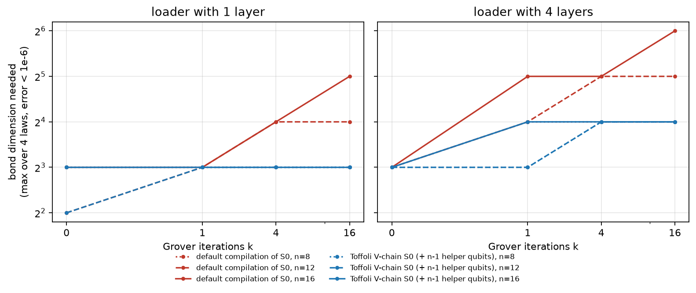
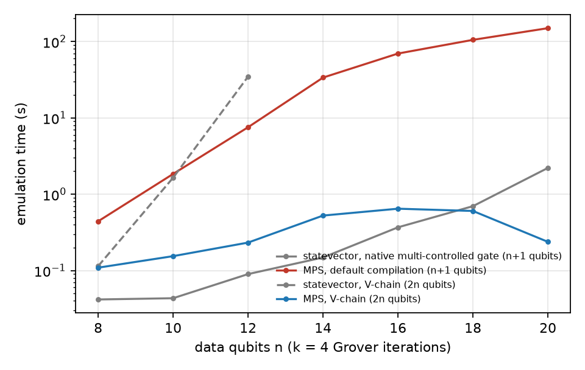

# qae-bonddim: how much bond dimension does quantum Monte Carlo need?

Quantum amplitude estimation (QAE) is the core of quantum Monte Carlo for pricing and risk. It runs three steps:
1. load a distribution with a shallow MPS loader;
2. rotate a payoff onto an ancilla;
3. repeat Grover iterations Q = A·S₀·A†·S_good to amplify the answer.

Before such a circuit goes to a QPU, someone has to emulate it. This repo measures what an MPS emulator needs for that: bond dimension, CNOTs and time. It uses the loaders from [warped-loading](https://github.com/mouadhassal/warped-loading) (a reimplementation of Haiqu/HSBC's method) on 4 laws (Lévy, log-normal σ=2, Estonian power prices, normal), with 8–20 data qubits and 0–16 Grover iterations, on Qiskit Aer's MPS method.

```
pip install qiskit qiskit-aer numpy scipy pandas matplotlib
python run.py chi && python run.py scale && python figures.py      # ~1.5 h on a laptop CPU
```

## Findings

**1. The bond dimension does not grow with Grover iterations, if the reflection is compiled well.**

The smallest MPS bond-dimension cap that reproduces P(ancilla = 1) to within 10⁻⁶ of the exact value sin²((2k+1)θ):



| Loader | S₀ compiled as | χ needed, k = 0 → 16 (n = 8, 12, 16) | CNOTs at n = 16, k = 16 |
|---|---|---|---|
| 1 layer | Toffoli V-chain (+ n−1 helper qubits) | **≤ 8 throughout** | 1,815 |
| 1 layer | Qiskit's default multi-controlled gate | 8 → 32 | 24,471 |
| 4 layers | Toffoli V-chain | 8 → 16 | 3,267 |
| 4 layers | Qiskit's default | 8 → 64 | 25,923 |

This is what the maths predicts. QAE keeps the state inside span{|ψ_good⟩, |ψ_bad⟩}, two low-rank MPS, so the state between iterations never needs more than about twice the loader's bond dimension. What grows is the transient entanglement inside the compiled multi-controlled Z. A V-chain of local Toffolis keeps it flat; the default synthesis, with no helper qubits, does not.

**2. On an MPS emulator, the compilation of S₀ is the cost.** At n = 16, k = 16, the V-chain circuit runs **38–127× faster** than the default one: 0.55–1.9 s vs 42–240 s across the 4 laws, single-threaded. Placing the helpers next to their data qubits made no difference: Aer's MPS reorders qubits itself. I expected it to matter and it did not.

**3. Statevector vs MPS: honest crossover** (k = 4 iterations, log-normal σ=2, 1-layer loader):



| Data qubits n | Statevector, native multi-controlled gate (n+1 qubits) | MPS, default compilation | MPS, V-chain (2n qubits) | Statevector, V-chain (2n qubits) |
|---|---|---|---|---|
| 12 | 0.09 s | 7.5 s | 0.23 s | 34.7 s |
| 14 | 0.15 s | 33.7 s | 0.53 s | 4 GiB, not run |
| 18 | 0.70 s | 105 s | 0.60 s | 1 TiB, not run |
| 20 | 2.2 s | 150 s | **0.24 s (40 qubits)** | 16 TiB, not run |

- **Statevector with a native multi-controlled gate wins up to about 16 data qubits.** From 18 on, MPS on the hardware-compiled circuit is as fast or faster: 0.60 s vs 0.70 s at n = 18, and 0.24 s vs 2.2 s at n = 20. Timings are single runs on a shared laptop CPU.
- **For the hardware-compiled circuit** (only 1- and 2-qubit gates, helper qubits included, i.e. what a QPU will actually run), the qubit count doubles. Statevector took 34.7 s at 24 qubits (n = 12). I did not run it beyond that: 4 GiB at n = 14 and 64 GiB at n = 16. The MPS emulator ran the same circuit in under a second up to 40 qubits (n = 20: 0.24 s, error 9·10⁻¹¹).

## What this suggests

- **For an emulator product:** QAE on MPS-loaded data is a natural tensor-network workload, but only if S₀ is compiled tensor-network-friendly. An emulator that receives a default-synthesised multi-controlled Z pays 13× the CNOTs and needs 2–4× the bond dimension. Recognising that gate, or emulating it natively, is worth more than any other optimisation here.
- **For quantum-advantage claims:** the loader is low-rank, the payoff rotation is low-rank, and so is the QAE state. In warped-loading's H5, payoff MPS ranks were ≤ 4 on the warped grid. Such instances are classically emulable at any number of Grover iterations, so they are good test benches but not where an advantage would come from.

## Limits

- **One emulator:** Qiskit Aer's MPS method, CPU, single thread. The timings are relative, not a benchmark of any product. I did not test Fermioniq's Ava.
- **Linear payoff only:** the payoff is a linear angle on the bin index (Woerner–Egger style). Comparator-based payoffs such as call options with a strike add their own gates.
- **Small data registers:** loaders were built exactly up to 20 data qubits, because building them needs the full 2ⁿ target vector.
- **Exact and noiseless:** χ "needed" means error < 10⁻⁶ against the exact amplitude.

---

Mouadh Abderrahmane Assal · More in my [portfolio](https://mouadh.vercel.app/) · [github.com/mouadhassal](https://github.com/mouadhassal)
